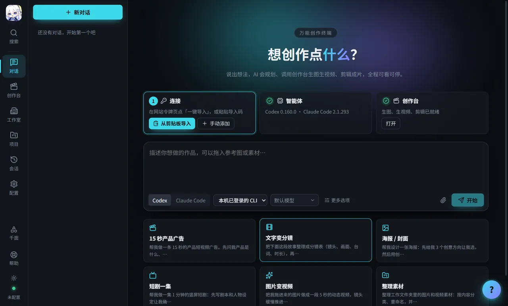
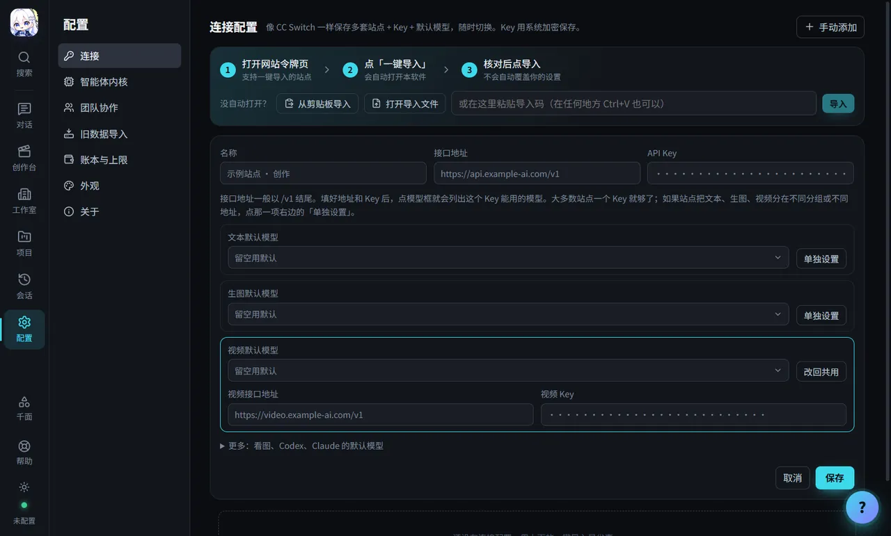
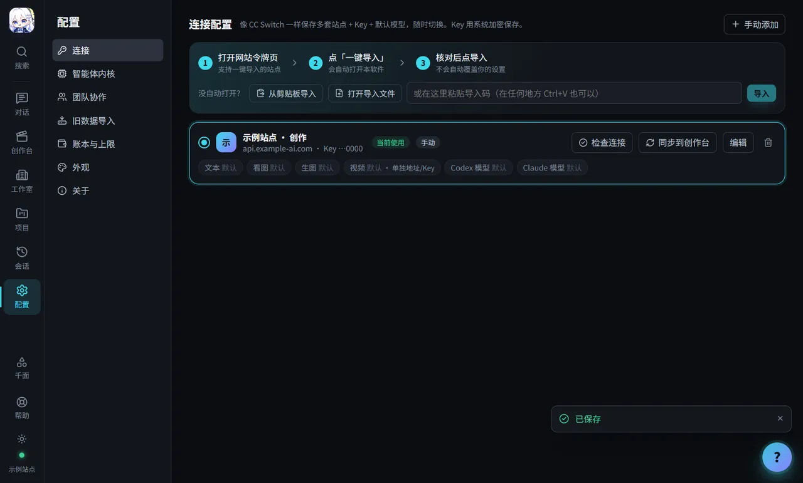
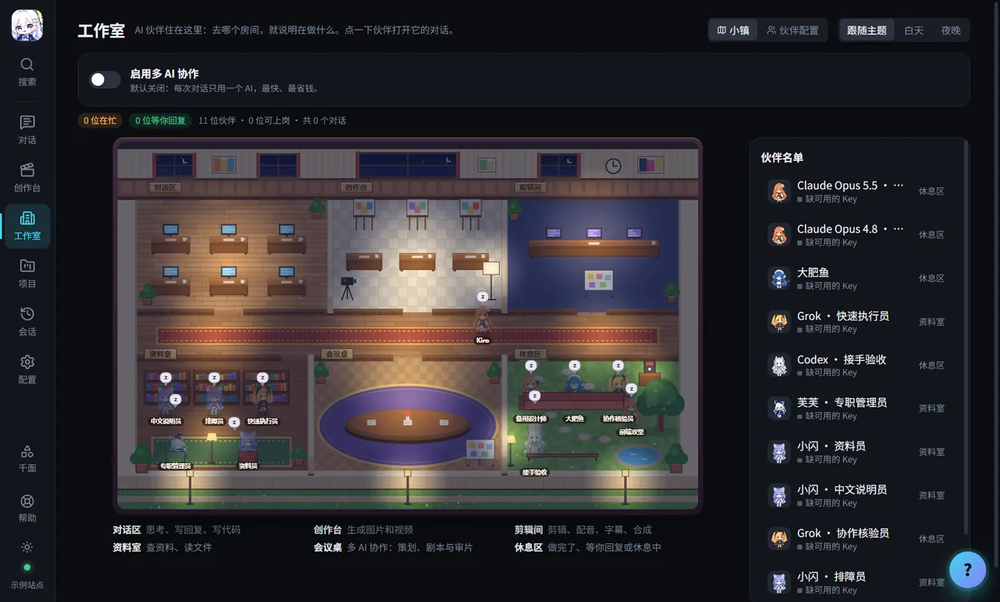
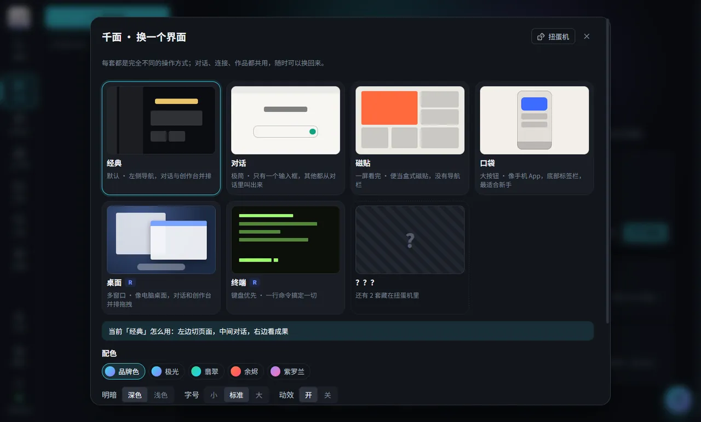
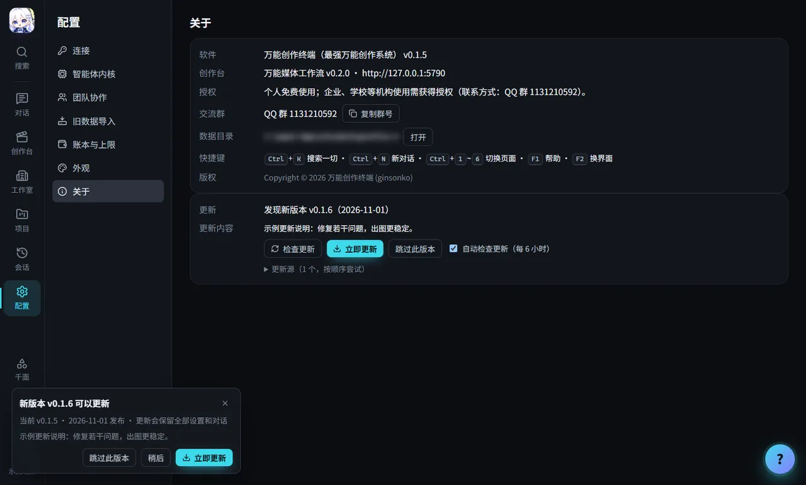
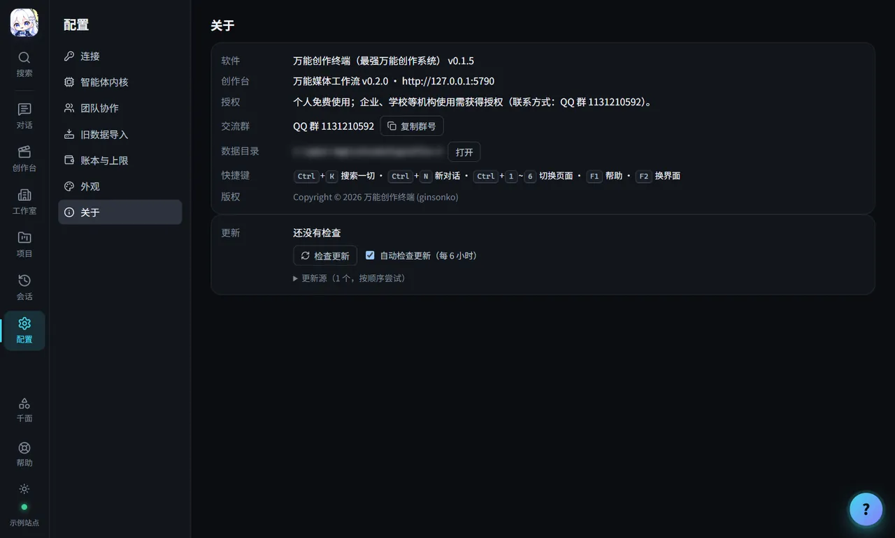

# 万能创作终端 · TideVerse 版使用手册

> TideVerse 版默认连接 [TideVerse](https://tideverse.cn)：用 TideVerse 账号登录，或在 TideVerse 控制台创建令牌后填进软件即可。下面的步骤对其他 OpenAI 兼容站点同样适用。

> 适用版本：v0.1.5 及以上（TideVerse 版）。
> 适合谁：第一次使用 AI 创作软件的新手，以及使用任意 **new-api / OpenAI 兼容** API 站点的用户。
> 只想最快用起来？先看 [TideVerse 版快速上手](TideVerse 版快速上手.md)。

手册里的截图来自 v0.1.5 TideVerse 版，画面中的站点和 Key 都是示例（`api.example-ai.com`、`sk-demo…`），不是真实可用的地址。软件里打开设置的入口在左侧导航最下面，名字叫 **「配置」**。

---

## 目录

1. [万能创作终端是什么](#1-万能创作终端是什么)
2. [下载](#2-下载)
3. [安装](#3-安装)
4. [第一次打开](#4-第一次打开)
5. [在 API 站点上准备 Key](#5-在-api-站点上准备-key)
6. [在软件里配置连接（文本 / 生图 / 视频）](#6-在软件里配置连接文本--生图--视频)
7. [功能导览（附例子）](#7-功能导览附例子)
8. [花费与上限](#8-花费与上限)
9. [更新](#9-更新)
10. [卸载](#10-卸载)
11. [常见问题](#11-常见问题)
12. [使用许可与交流群](#12-使用许可与交流群)

---

## 1. 万能创作终端是什么

万能创作终端（英文名 OmniCreator）是一个桌面软件，把两样东西装在了一起：

- **AI 对话助手**：可以选 **Codex** 或 **Claude Code** 当“引擎”。你说一句需求，它会自己规划、动手、检查，把成果交给你。
- **创作台（万能媒体工作流）**：一整套图片、视频创作工具，包括自由创作、画布创作、项目与剧集、批量生成、3D 导演台、媒体素材库等。

软件本身**不提供模型**。它连接你选择的 API 站点，用你在站点上创建的 Key 调用文本、图片、视频模型。费用由站点按实际用量收取。

一句话：**你说想做什么，它帮你写、帮你画、帮你做视频，成果自动保存。**

---

## 2. 下载

1. 打开官网的「下载」区域，或打开 GitHub 发布页：<https://github.com/ginsonko/tideverse/releases>
2. 按你的电脑选择文件：

| 你的电脑 | 选择 | 文件名示例 |
| --- | --- | --- |
| Windows 10 / 11（64 位），想正常安装 | **Windows 安装版**（推荐） | `OmniCreator-TideVerse-0.1.5-Setup.exe` |
| Windows，不想安装 / 放 U 盘里用 | Windows 免安装版 | `OmniCreator-TideVerse-0.1.5-Portable.exe` |
| Mac，Apple 芯片（M1 / M2 / M3 / M4…） | macOS Apple 芯片版 | `OmniCreator-TideVerse-0.1.5-mac-arm64.dmg` |
| Mac，Intel 处理器 | macOS Intel 版 | `OmniCreator-TideVerse-0.1.5-mac-x64.dmg` |

> 文件名以发布页为准，版本号会随更新变化。Mac 版需要 macOS 13 及以上。发布页上还有同名的 `.zip`，和 `.dmg` 是同一个应用（软件自动更新时用它），一般下载 `.dmg` 即可。

**怎么知道 Mac 是哪种芯片？** 点屏幕左上角的苹果图标 →「关于本机」。写着「芯片 Apple M…」就是 Apple 芯片；写着「处理器 Intel…」就是 Intel。

**GitHub 下载很慢怎么办？**

- 如果官网的下载卡片上有「国内镜像」按钮，用镜像下载更快，文件内容与 GitHub 完全一致。
- 也可以在 QQ 群 1131210592 的群文件里获取。

**（可选）校验文件是否完整**

官网每个下载卡片上都有一串 64 位的 SHA256 校验值。

- Windows：在下载文件所在的文件夹里，按住 Shift 点右键 →「在此处打开 PowerShell 窗口」，输入：
  ```
  Get-FileHash .\OmniCreator-TideVerse-0.1.5-Setup.exe
  ```
- Mac：打开「终端」，输入：
  ```
  shasum -a 256 ~/Downloads/OmniCreator-TideVerse-0.1.5-mac-arm64.dmg
  ```

显示的结果和官网一致，就说明文件完整、没有被改动过。

---

## 3. 安装

### 3.1 Windows 安装版

1. 双击下载的 `…-Setup.exe`。
2. 如果出现蓝色窗口「Windows 已保护你的电脑」：点 **更多信息** → **仍要运行**。（内测版还没有代码签名，所以会被拦一下。）
3. 安装程序会问装给谁、装在哪里，一路点「下一步」即可，**不需要管理员权限**。
4. 安装完成后，桌面和开始菜单会出现「万能创作终端」。
5. 杀毒软件如果提示，请选择「信任 / 允许」。
6. 安装时会显示使用许可：个人使用免费；公司、学校等机构使用需获得授权。

### 3.2 Windows 免安装版

1. 把 `…-Portable.exe` 放到任意文件夹（例如 `D:\工具\`）或 U 盘。
2. 双击运行。第一次启动需要先解压，会比安装版慢一些，请耐心等待。
3. 同样可能出现「Windows 已保护你的电脑」，处理方法同上。

### 3.3 macOS

1. 双击下载的 `.dmg` 文件。
2. 在弹出的窗口里，把「万能创作终端 TideVerse」图标**拖到**旁边的「应用程序」文件夹。（应用包叫 万能创作终端 TideVerse.app，打开后菜单栏、程序坞里显示「万能创作终端」。）
3. 复制完成后，在访达侧边栏右键安装盘 →「推出」。
4. 打开「访达」→「应用程序」，找到「万能创作终端 TideVerse」。

**第一次打开（只需做一次）**：内测版没有 Apple 签名和公证，第一次打开会提示「无法验证开发者」。

- **macOS 15 及以上**：先双击打开一次，出现提示后点「完成」（不要点「移到废纸篓」）；然后打开 **系统设置 → 隐私与安全性**，向下滚动到「安全性」，在「已阻止“万能创作终端 TideVerse”」旁边点 **「仍要打开」**，输入登录密码确认，再在弹窗里点「仍要打开」。
- **macOS 13 / 14**：在「应用程序」里 **右键（或按住 Control 键点按）万能创作终端 TideVerse →「打开」**，在弹窗里再点「打开」。

如果提示「已损坏，无法打开，你应该将它移到废纸篓」：

1. 打开「终端」（在「应用程序 → 实用工具」里）。
2. 复制下面这一行，粘贴进去，按回车（会要求输入登录密码，输入时屏幕上不显示，输完按回车）：
   ```
   sudo xattr -dr com.apple.quarantine "/Applications/万能创作终端 TideVerse.app"
   ```
3. 再双击打开软件即可。

> 这是因为内测版还没有经过苹果公证，并不代表文件有问题。
> Mac 版**不内置 Codex**：打开软件后，在首页提示或 **配置 → 智能体内核** 里点「一键安装 Codex」，不需要 Node.js，也不需要管理员权限，国内网络会自动换镜像。电脑上已经装过 Codex 的，软件会自动找到。
> 界面里写的 `Ctrl` 快捷键，在 Mac 上用 `⌘`（Command）。关闭窗口就会退出软件。

---

## 4. 第一次打开

1. 打开软件后会看到欢迎窗口：可以点「带我走一遍（30 秒）」看新手导览，也可以点「我自己逛逛」。欢迎窗口里还可以先选一种喜欢的操作方式（经典、对话、磁贴、口袋），以后随时能换。
2. 首页中间是一个输入框，这就是和 AI 对话的地方。输入框上方有三张「准备」卡片：**连接**、**智能体**、**创作台**，没准备好的会给你按钮。
3. 现在还不能创作，因为还没有连接 API 站点。下一步先去站点准备 Key。



几个随时有用的按键：

| 按键 | 作用 |
| --- | --- |
| `F1` | 打开帮助，可以直接问“第一次用怎么开始” |
| `F2` | 换界面（千面） |
| `Ctrl + K` | 搜索一切：页面、功能、对话 |
| `Ctrl + N` | 新对话 |

> Mac 上把 `Ctrl` 换成 `⌘`（Command）。

---

## 5. 在 API 站点上准备 Key

本软件可以连接**任何兼容 OpenAI 接口的站点**。最常见的是用 new-api 搭建的站点，下面以 new-api 的常见界面为例。不同站点的菜单名字可能略有不同（例如「令牌」也可能叫「API Key」「密钥」），意思是一样的。

### 5.1 注册并充值

1. 打开你选择的 API 站点，点「注册」，按提示完成注册并登录。
2. 进入「钱包」或「充值」页面，按站点说明充值（在线支付或使用兑换码）。
3. 进入「模型广场」或「定价」页面，看看站点有哪些模型、各自什么价格。记下三类模型的名字：
   - **文本模型**：用来对话、写文案、写脚本，例如站点推荐的对话模型。
   - **图片模型**：用来生成图片，名字里常带 `image`。
   - **视频模型**：用来生成视频，站点通常会标注为“视频”。

### 5.2 创建 Key（令牌）

**大多数站点一个 Key 就够了**：同一个 Key 能调用文本、生图、视频模型时，软件里只填一次。
如果站点把文本、生图、视频分在**不同分组**（一个 Key 只能用一个分组），或者你想**分别看到每一类花了多少钱**，就按用途多建几个 Key（例如文本一个、生图一个、视频一个），软件里可以给每一项「单独设置」Key，甚至单独的接口地址（见 6.1）。

1. 在站点控制台进入「令牌」（或「API Key」）页面，点「添加令牌」。
2. 填写：
   - **名称**：例如 `创作终端`（多建时可以叫 `创作终端-文本`、`创作终端-生图`、`创作终端-视频`）
   - **过期时间**：可以选「永不过期」，或按你的习惯设置
   - **额度**：建议先设一个上限，例如 20 元，避免意外多花
   - **模型限制**：可以不填；想更安全就只勾选你要用的模型
   - **分组**：按站点说明选择（不确定就用默认）
3. 点「提交」。
4. 在令牌列表里点这个令牌的「复制」，复制出来是一串以 `sk-` 开头的文字，这就是 Key。

> **Key 就像密码**：不要发到群里、不要截图公开、不要发给任何人（包括 AI 助手）。

### 5.3 找到接口地址

接口地址（也叫 Base URL）一般是：

```
https://你的站点域名/v1
```

很多站点会在首页或文档里直接写出来，例如「API Base：`https://api.example.com/v1`」。

---

## 6. 在软件里配置连接（文本 / 生图 / 视频）

### 6.1 手动添加连接

1. 打开软件，点左侧导航的 **配置 → 连接**。
2. 点右上角 **「手动添加」**。
3. 填写最上面一行（这是**共用**的地址和 Key）：
   - **名称**：随便起，例如 `我的站点 · 创作`。
   - **接口地址**：上一步找到的地址，例如 `https://api.example.com/v1`（一般以 `/v1` 结尾）。
   - **API Key**：粘贴你复制的 Key。
4. 选三项 **默认模型**：**文本默认模型**、**生图默认模型**、**视频默认模型**。
   - 填好地址和 Key 后，点模型框就会**列出这个 Key 能用的模型**，可以搜索，直接点选即可。留空就用默认。
   - 某一项要用**别的 Key 或别的地址**（例如站点把视频放在另一个分组）：点那一项右边的 **「单独设置」**，会多出「…接口地址」和「… Key」两个框；地址留空就用上面的地址，Key 留空就用上面的 Key。想改回来点「改回共用」。
   - 展开下面的 **「更多：看图、Codex、Claude 的默认模型」** 可以再选看图模型（让 AI 看懂图片用）和两个编程助手的模型，不确定就留空。
5. 点 **「保存」**。
6. 在刚添加的连接卡片上点 **「检查连接」**。看到“连接正常，可用模型 N 个”就成功了。卡片上会列出每一项用的模型，单独设置过的一项后面会写「单独地址/Key」。
7. （可选）点 **「同步到创作台」**，把文本、生图、视频模型同步给创作台使用。这一步只读取模型列表，不花钱。





### 6.2 多套连接，随时切换

你可以添加多套连接（例如两个不同的站点）。连接卡片左边的圆点表示“当前使用”，点另一张卡片的圆点就切换过去。

### 6.3 Key 存在哪里？

Key 用系统自带的加密方式保存在你的电脑上（Windows 用系统加密，Mac 用钥匙串），**不会上传**。Mac 更新到新版本后，系统可能再问一次是否允许访问钥匙串里的「万能创作终端 Safe Storage」，点「始终允许」即可。软件里的 Codex / Claude Code 使用你在这里配置的 Key，**不会改动**你电脑上原有的 Codex / Claude 配置。

### 6.4 连接失败怎么办

| 提示 | 可能原因 | 处理 |
| --- | --- | --- |
| 401 / 无效的令牌 | Key 复制不完整或已删除 | 回站点重新复制 Key |
| 403 / 无权使用该模型 | 令牌的「模型限制」里没勾这个模型，或分组不支持 | 到站点编辑令牌，或换一个模型 |
| 余额不足 | 站点余额或令牌额度用完了 | 到站点充值，或调高令牌额度 |
| 404 / 地址错误 | 接口地址少了 `/v1` 或写错了域名 | 核对接口地址 |
| model_not_found | 站点上没有这个模型名 | 在下拉列表里重新选择模型 |

---

## 7. 功能导览（附例子）

下面每个例子里的话，都可以直接复制到软件首页的输入框里用。

### 7.1 写文案

在首页输入框里说：

> 给新品焦糖拿铁写 3 条小红书文案，每条不超过 80 字，语气轻松，带 2 个话题标签。

AI 会用你配置的**文本模型**来写。不满意就接着说“第二条再活泼一点”“改成适合朋友圈的版本”。

### 7.2 生成图片

> 帮我做一张新品咖啡海报，暖色调，竖版，顶部留出标题位置。

- 通常 1 到 2 分钟出图，图片会出现在对话下方和右侧「作品」栏，自动保存。
- 有参考图？**直接把图片拖进输入框**，或点输入框右下角的回形针，再说“参考这张图的配色”。
- 想用某个具体模型，直接在话里点名：“用 某某图片模型 画”。

### 7.3 生成视频

> 把这张图做成 5 秒视频，镜头缓慢推近，保留原图风格。

- 视频一般需要几分钟，助手会一直等到出结果，你可以先去做别的事。
- 做好的视频同样在「作品」里，点开可以预览、在文件夹中显示。

### 7.4 用 Codex / Claude Code 对话做项目

对话页的“引擎”可以选：

- **Codex**：速度快，擅长按步骤执行，推荐新手先用它。
- **Claude Code**：长文、剧本、细致修改更强。

两种引擎都能直接调用创作台出图、出视频、剪辑。例子：

> 我要给咖啡店做一套开业宣传：1 张主海报、3 张朋友圈配图、1 条 15 秒短视频，再写一段开业文案。先给我方案，我确认后再做。

小技巧：

- 输入框下方可以**换模型**（按对话 / 绘图 / 视频分类，可搜索、可收藏）。
- AI 工作时你也能插话：按 **Enter** 排队，等这一步做完再处理；按 **Ctrl+Enter** 立刻打断并按新要求继续，之前的进度会保留。
- 「更多选项」里有三档**权限**：
  - **安全模式**（默认）：只能读写这次对话的文件夹。
  - **可运行命令**：可以运行命令、搜索网页，但仍限在对话文件夹里。
  - **完全访问**：可以操作电脑上的任何文件，只在你信任的任务里使用。
- 第一次使用某个引擎，如果提示缺少组件，到 **配置 → 智能体内核** 点「一键安装」即可，装在软件自己的文件夹里，不影响系统。

### 7.5 创作台（万能媒体工作流）

点左侧导航的「创作台」，常用页面：

| 页面 | 用途 |
| --- | --- |
| 自由创作 | 直接生图、生视频，适合快速试 |
| 画布创作 | 把剧本、素材、镜头放在一张画布上，适合漫剧、分镜 |
| 项目与剧集 | 做短剧、系列内容，按集管理 |
| 批量生成 | 一次提交多条图片 / 视频任务 |
| 3D 导演台 | 镜头与机位预演 |
| 媒体素材库 | 所有生成过的图片、视频、音频 |
| 零成本流程模拟 | 不花钱走一遍完整流程，适合先熟悉 |

你也可以在对话里直接说“用创作台帮我……”，AI 会自己去操作。例如：

> 做一个三格小漫剧：主角是一只想当程序员的橘猫。先给我分镜，再逐格出图。

AI 会在创作台里建一张画布，逐格出图，之后你可以在画布里接着改。

### 7.6 工作室与项目档案

- **工作室**：一间像素风小办公室，每个对话是一位 AI 同事。它在思考、生图、剪辑还是等你回复，一眼就能看到；点一下就跳到那个对话。快捷键 `Ctrl+3`。
- **项目**：同一个文件夹、同一类主题的对话会自动归成一个项目，记下目标、已定的要求、成果和还没完成的事。点 **「继续这个项目」** 会开一个新对话并自动带上背景，不用从头解释。
- **会话**：所有对话都在这里，可以搜索、筛选，还能浏览你电脑上 Codex / Claude Code 用过的会话并在本软件里接着做。



### 7.7 换皮肤（千面）

按 `F2`，或在 **配置 → 外观** 里换界面。换的不只是颜色，连操作方式都不一样，数据和对话全部共用：

| 界面 | 特点 |
| --- | --- |
| 经典 | 默认，左侧导航，对话与创作台并排 |
| 对话 | 极简，只有一个输入框，其他都从对话里叫出来 |
| 磁贴 | 一屏看完所有功能，点开全屏 |
| 口袋 | 像手机 App，底部大按钮，**最适合新手** |
| 桌面 | 多窗口，像电脑桌面一样拖拽摆放 |
| 终端 | 键盘优先，输入 `/帮助` 看命令 |
| 驾驶舱、街机 | 隐藏款，每天可以在扭蛋机里扭一次解锁 |

还可以描述你想要的样子，让 AI 帮你设计一套自定义皮肤。



### 7.8 帮助

按 `F1` 打开帮助助手，直接问，例如：

- “第一次用怎么开始？”
- “生成的作品在哪？”
- “怎么换成口袋界面？”

它会回答，还能带你跳到对应的页面。

---

## 8. 花费与上限

- 对话、写文案按 token 计费；生图、生视频按站点价格扣费。**实际以站点扣费为准。**
- **配置 → 账本与上限** 里可以看到花费，并设置上限：单个对话、每天、每月，到了自动停止。默认上限是单个对话 ¥5、每天 ¥20、每月 ¥200，可以自己改。
- 建议同时在站点上给每个令牌设置额度，双保险。
- 想零成本先熟悉流程：创作台里有「零成本流程模拟」。

---

## 9. 更新

- 软件启动 **1 分钟后**检查一次有没有新版本，之后**每 6 小时**检查一次。
- 有新版本时，窗口左下角出现一个小提示，写清楚版本号、发布日期和更新了什么，有三个按钮：
  - **「立即更新」**：下载新版本，校验文件完整（SHA256）后自动安装并重启。下载断了会**接着下载**，不用从头来。
  - **「稍后」**：这次先不更新，下次启动再提醒。
  - **「跳过此版本」**：这个版本不再提醒，等更新的版本出来再说。
- **从不强制更新。** 在 **配置 → 关于** 里可以点 **「检查更新」** 手动检查，也可以取消勾选「自动检查更新（每 6 小时）」。
- 更新会保留全部设置和对话，不影响你的作品和连接配置。
- 免安装版会直接替换原来的 exe；如果 exe 所在的文件夹不能写入，软件会把下载好的新版本在文件夹中显示出来，手动替换即可。



---

## 10. 卸载

### Windows 安装版

任选一种：

- 在软件 **配置 → 关于** 最下面的「卸载 / 清理」一栏点 **「卸载本软件」**；
- 或打开 Windows **设置 → 应用**，找到「万能创作终端」，点「卸载」。

卸载程序会**先关掉软件和它启动的所有后台进程**（不会再留下删不掉的文件），然后**询问是否同时删除你的数据**（设置、对话、作品库和下载的工具），**默认是「否」，也就是保留**。想重装后接着用，就保留；想彻底删干净，就选「是」。

### Windows 免安装版

1. 想删除数据：打开软件 **配置 → 关于**，在「卸载 / 清理」一栏点 **「清除软件数据」**（会删除连接配置和 Key、对话记录、作品库和下载的工具，不能恢复；软件会先关闭）。
2. 删除免安装版的 `.exe` 文件即可。

### Mac

1. 退出软件（`⌘ + Q`）。
2. 打开「应用程序」，把「万能创作终端 TideVerse」拖到废纸篓。
3. 想彻底清理：在访达里按 `⌘ + Shift + G`，前往下面的文件夹并删除（对话、配置、作品库和日志都在里面）：
   ```
   ~/Library/Application Support/万能创作终端
   ```

> 数据文件夹的准确位置可以在 **配置 → 关于 → 数据目录** 查看，旁边的「打开」按钮能直接打开它。



---

## 11. 常见问题

**Q：软件要钱吗？**
A：下载和个人使用免费。模型调用费用由你连接的 API 站点收取。

**Q：要建几个 Key？**
A：一个就够，软件里填一次就行。站点把文本、生图、视频分在不同分组，或你想分开看花费时，可以多建几个，在连接表单里给那一项点「单独设置」，填它自己的 Key（和地址）。

**Q：要先装 Codex、Claude Code 或 Node.js 吗？**
A：不用提前装。Windows 安装版自带 Codex；免安装版和 Mac 版缺少时，到 **配置 → 智能体内核** 点「一键安装 Codex」，不需要 Node.js。

**Q：会自动更新吗？会不会强制升级？**
A：会提醒，不强制。见 [第 9 节](#9-更新)。

**Q：我的站点支持「一键导入」，还用手动配置吗？**
A：不用。看 [第三方智能路由站点接入手册](第三方智能路由站点接入手册.md)，点一下就能把配置带进软件。

**Q：生成的作品保存在哪？**
A：每个对话有自己的成果文件夹。成果显示在对话下方和右侧「作品」栏，点开大图可以「在文件夹中显示」。

**Q：对话出错了 / 一直没反应？**
A：
1. 对话出错时，点错误下方的「让 AI 排查并继续」。
2. 想换方向：点「停止」，再补充要求。
3. 到 **配置 → 连接** 点「检查连接」，看 Key 是否有效、余额是否充足。
4. 创作台页面空白：点创作台顶部的刷新按钮。

**Q：以前用过「万能媒体工作流」，数据能搬过来吗？**
A：可以。到 **配置 → 旧数据导入** 点「查找旧数据」，先看预览，确认后再导入。导入是复制，旧数据原样保留。

**Q：在哪反馈问题？**
A：加 QQ 群 1131210592，或到 GitHub Issues：<https://github.com/ginsonko/tideverse/issues>。请附上截图、出问题前做了什么，以及 **配置 → 关于** 里的版本号，并说明是 Windows 安装版、免安装版还是 Mac 版。

---

## 12. 使用许可与交流群

- **个人使用免费。**
- **公司、学校等机构使用需获得授权**，请联系 QQ 群 **1131210592**。
- 安装时会显示许可说明，软件 **配置 → 关于 → 授权** 里也能看到。
- 使用软件生成的内容，请遵守所用 API 站点的服务条款和相关法律法规。

用户交流群：**QQ 群 1131210592**（使用问题、建议、机构授权都可以在群里找到我们）。
